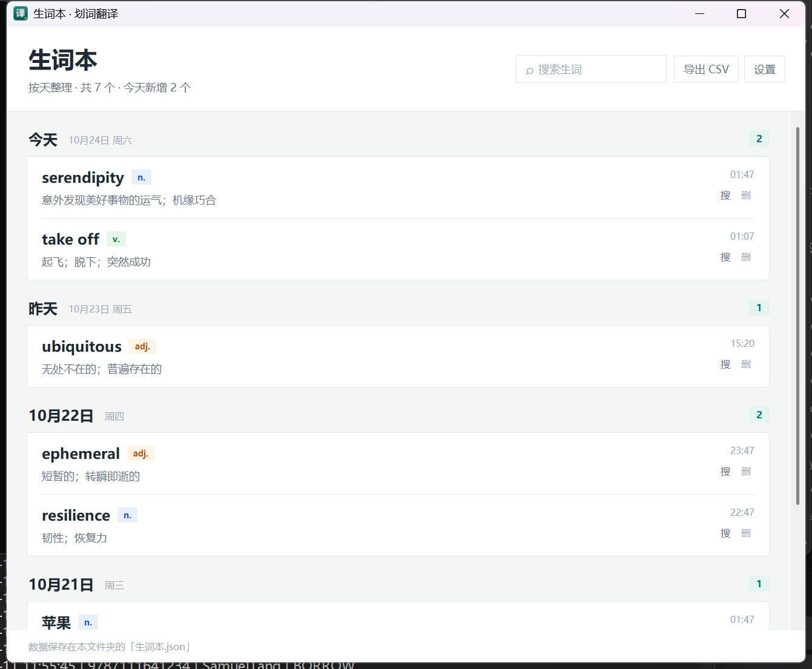
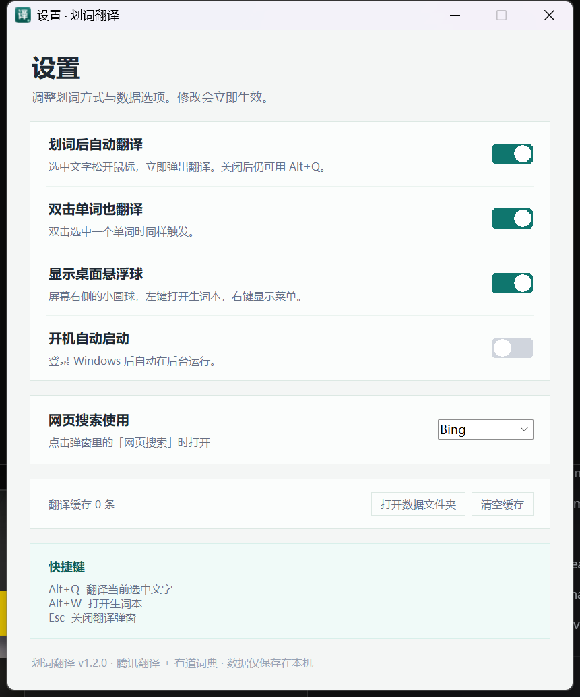

# 划词翻译

一个面向 Windows 的轻量划词翻译工具：选中文字、松开鼠标，翻译结果就会出现在鼠标旁。

- **中英自动识别**：英文单词显示词性、释义、常用短语、词形变化、例句；中文自动译成英文。
- **先简后详**：默认只显示一小块简明译文；鼠标移到弹窗上才展开完整信息，移开自动收起。
- **响应很快**：腾讯翻译 + 有道词典双通道，常用词写入本地缓存，重复查询几乎即时出现。
- **按天生词本**：一键收藏，按「今天 / 昨天 / 具体日期」分组，支持搜索、删除、导出 CSV。
- **网页搜索与发音**：在弹窗里直接搜索 Bing / 百度 / Google / 有道，点击音标旁按钮播放有道发音。
- **紧凑玻璃 UI**：Win32 圆角裁剪、半透明卡片、浅色描边；支持淡入/展开过渡。

> 这是一个非官方工具，与腾讯、有道无关联。翻译内容会发送到对应的公开接口，使用前请阅读 [隐私说明](PRIVACY.md)。

## 界面

| 紧凑模式 | 悬停展开 |
| --- | --- |
|  |  |

| 生词本 | 设置 |
| --- | --- |
|  |  |

## 下载与安装

支持 **Windows 10 / 11 64 位**，发布版不需要安装 Python。

在 [GitHub Releases](https://github.com/ddafina233/huaci-translator/releases/latest) 页面下载：

- `hcfy-setup-1.2.0.exe`：推荐，安装版。按用户安装到 `%LOCALAPPDATA%\Programs\划词翻译`，不需要管理员权限，带开始菜单快捷方式和卸载程序。
- `hcfy-portable-1.2.0.exe`：免安装单文件。配置和生词本会保存在 exe 所在目录，请放在有写入权限的文件夹。

更完整的安装、数据备份和卸载说明见 [docs/安装说明.md](docs/安装说明.md)。

## 从源码运行

要求：Python 3.10+，Windows 10/11。

```powershell
git clone https://github.com/ddafina233/huaci-translator.git
cd 划词翻译
python 划词翻译.pyw
```

也可以双击 `启动.vbs`（无黑色控制台窗口）或 `启动.bat`。

运行时只使用 Python 标准库（tkinter / ctypes / http.client / json 等），不需要 `pip install`。

## 使用

1. 在浏览器、Word、PDF 阅读器、微信等软件里拖选文字；
2. 松开鼠标，先出现紧凑译文；
3. 鼠标移到弹窗上展开完整释义和操作按钮，移开自动收起；
4. 点「＋ 生词本」收藏，或点「网页搜索」查更多资料。

| 快捷键 | 作用 |
| --- | --- |
| `Alt+Q` | 翻译当前选中文字 |
| `Alt+W` | 打开生词本 |
| `Esc` | 关闭翻译弹窗 |

如果快捷键被占用，程序会自动尝试 `Ctrl+Alt+Q` / `Ctrl+Alt+W`，实际键位显示在设置窗口。

## 数据与隐私

- 没有账号、没有 API Key、没有自建服务器，也不收集统计信息。
- 选中的文字会发送到腾讯翻译（TranSmart）和有道词典的公开接口；失败时可能尝试百度词典 / MyMemory。
- 生词本、设置、翻译缓存、运行日志都只保存在本机。
- 日志不记录选中的文字内容。
- 仓库不会包含用户数据；`.gitignore` 已排除 `生词本.json`、`翻译缓存.json`、`设置.json` 和 `运行日志.log`。

详见 [PRIVACY.md](PRIVACY.md)。

## 构建 exe / 安装包

构建需要：

- Python 3.10+
- [PyInstaller](https://pyinstaller.org/)：`pip install -r requirements-dev.txt`
- [Inno Setup 6/7](https://jrsoftware.org/isinfo.php)：用于生成安装包

在仓库根目录运行：

```powershell
powershell -ExecutionPolicy Bypass -File packaging\build.ps1
```

输出：

- `packaging\dist\划词翻译\`：PyInstaller 免安装目录
- `packaging\portable\划词翻译-便携版.exe`
- `packaging\installer\划词翻译-安装包.exe`

详细说明见 [docs/构建说明.md](docs/构建说明.md)。构建产物和安装包不应提交到 Git，请上传到 GitHub Releases。

## 项目结构

```text
.
├─ 划词翻译.pyw           # 主程序 / UI / 全局事件调度
├─ winutil.py             # Win32 剪贴板、全局钩子、热键、圆角、DPI
├─ trans_core.py          # 腾讯翻译、有道词典、缓存
├─ vocab_store.py         # 生词本存储、按天分组、CSV 导出
├─ 启动.vbs / 启动.bat   # 源码版启动脚本
├─ 图标.ico / 图标.png   # 图标
├─ docs/                  # 安装说明、构建说明、截图
├─ packaging/             # PyInstaller / Inno Setup 构建脚本
└─ .github/               # CI、Issue / PR 模板
```

## 已知限制

- 仅支持 Windows；发布版为 x64。
- 某些以管理员权限运行的窗口不接受普通程序的模拟复制，可能无法自动划词。可以先手动 `Ctrl+C`，再按 `Alt+Q`。
- 扫描版 PDF / 图片没有文本层，无法直接划词。
- Tk 无法实现系统级 Acrylic 实时模糊，当前磨砂玻璃由半透明、圆角、描边和高光模拟。
- 翻译接口可能限流或变更；失败时弹窗会提供重试和网页搜索。

## 贡献

欢迎提交 Issue 和 Pull Request。提交前请阅读 [CONTRIBUTING.md](CONTRIBUTING.md)，并确保不要提交个人生词本、缓存或日志。

## 许可证

代码以 [MIT License](LICENSE) 发布。第三方翻译服务、商标和接口的使用受各自条款约束。

